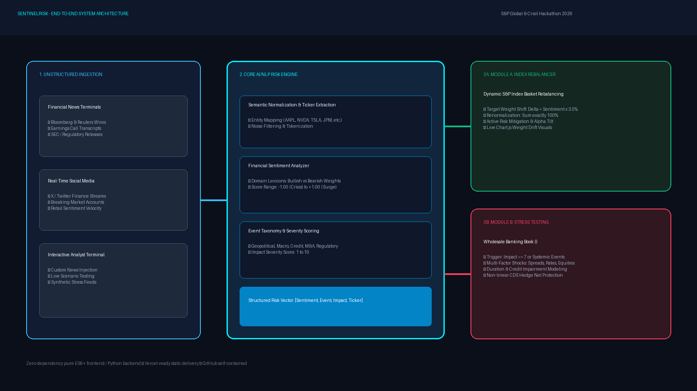
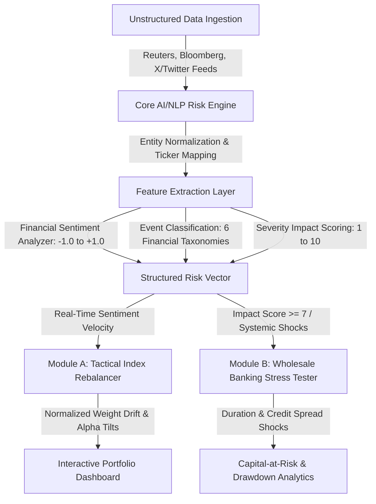

# SentinelRisk: AI/NLP Financial Risk Engine & Capital Analytics - S&P Global & Crisil Campus Hackathon 2026
 
**Candidate Name:** Aayushi  
**College Email ID:** [aayushi003bteceai23@igdtuw.ac.in]   
**College / Campus:** [Indira Gandhi Delhi Technical University for Women]  
**Demo Video Link:** [https://youtu.be/UNLISTED_DEMO_LINK](https://youtu.be/UNLISTED_DEMO_LINK)  *(Upload unlisted 10-min recording and paste link)*  
**Slide Deck Link:** [docs/presentation.pdf](docs/presentation.pdf) • [Direct Browser PDF](https://financial-risk-engine-2.vercel.app/docs/presentation.pdf) • [Raw GitHub PDF](https://raw.githubusercontent.com/Aayushi002929/financial-risk-engine/main/docs/presentation.pdf)  
**Live Application (Vercel):** [https://financial-risk-engine-2.vercel.app](https://financial-risk-engine-2.vercel.app)  

 
---

## 1. Project Overview / Problem Statement & Approach

### The Problem
Financial institutions operate in an environment where market-moving events are broadcast first across unstructured text streams—breaking news wires, regulatory filings, earnings disclosures, and social media channels (X/Twitter). Traditional risk surveillance systems are constrained by latency; they rely predominantly on backward-looking historical volatility, delayed credit rating actions, and end-of-day price closures. By the time a corporate default, regulatory investigation, or geopolitical embargo is priced in by conventional models, substantial capital impairment has already occurred.

### Our Solution & Approach
**SentinelRisk** is an end-to-end financial intelligence and risk quantification platform that bridges unstructured market intelligence and quantitative portfolio decision-making. The system continuously ingests raw, high-velocity text from financial news wires and social feeds, transforming noisy text into structured, machine-readable risk vectors.

To demonstrate the practical utility of these risk signals across both equity asset management and institutional credit banking, SentinelRisk implements **both** downstream financial applications:
1. **Module A (Tactical Index Rebalancer):** Dynamically adjusts constituent weights in an S&P 10-equity index basket based on real-time sentiment velocity while maintaining exact $100.00\%$ mathematical normalization.
2. **Module B (Strategic Wholesale Banking Stress Testing):** Evaluates a $\$140\text{M}$ synthetic wholesale banking asset book (Commercial Loans, Corporate Bonds, Sovereign Debt, and Derivative Swaps/Hedges) by automatically triggering multi-factor macroeconomic and credit shocks when high-severity events ($\ge 7/10$) are detected.

---

## 2. Architecture & Tech Stack

### System Design & Data Flow
The architecture consists of a decoupled three-stage pipeline: **Ingestion**, **NLP Signal Extraction**, and **Dual Financial Execution Modules**.





### Key Frameworks & Libraries
- **NLP & Processing Engine:** Pure ES6+ modular analytics (`src/engine.js`) alongside a headless Python 3 pipeline (`main.py`, `src/cli_engine.py`) using domain-calibrated financial lexicons and multi-factor severity scoring.
- **Frontend & Visualization:** Modern HTML5, TailwindCSS (glassmorphic terminal UI via CDN), Chart.js (responsive canvas rendering for weight drift and stress drawdowns), Lucide Icons.
- **Deployment & Cloud:** Zero-dependency static architecture optimized for instant, zero-config deployment to **Vercel** and **GitHub Pages** with sub-50ms worldwide latency.

---

## 3. Dataset Used

All datasets used in this prototype are located in the [`/data`](data/) directory and represent synthetic, non-proprietary data modeled after institutional banking structures:

1. **[`data/sample_feeds.json`](data/sample_feeds.json):**
   - **Nature:** 6 multi-source unstructured financial text snippets spanning institutional news wires (Bloomberg, Reuters, WSJ) and social streams (X/Twitter Finance).
   - **Coverage:** Bullish AI product announcements, regulatory DOJ probes, Middle Eastern geopolitical maritime blockades, commercial real estate syndicated debt defaults, and Federal Reserve interest rate statements.
2. **[`data/sp100_constituents.json`](data/sp100_constituents.json):**
   - **Nature:** 10 blue-chip equities from the S&P universe (`AAPL`, `MSFT`, `NVDA`, `AMZN`, `GOOGL`, `JPM`, `TSLA`, `XOM`, `PFE`, `GS`) with sector tags and baseline percentage allocations summing to $100\%$.
3. **[`data/wholesale_banking_portfolio.json`](data/wholesale_banking_portfolio.json):**
   - **Nature:** A $\$140\text{M}$ synthetic wholesale credit book comprising Commercial Loans, Senior Corporate Bonds, Sovereign Debt, Interest Rate Swaps, and Credit Default Swap (CDS) index hedges with assigned durations, credit ratings, and carrying values.

### Assumptions
- Text feeds are ingested sequentially or in simulated batches simulating live WebSocket feeds.
- Downstream rebalancing enforces a $2.0\%$ minimum constituent weight floor to prevent total asset divestment.
- Stress testing calculates credit impairment using modified duration and spread sensitivities calibrated to standard Basel III wholesale credit practices.

---

## 4. Quickstart & Installation

**Runtime:** Python 3.10+ / Node.js 18+ (tested on Windows 11, macOS, and Linux)

### Step-by-Step Local Setup:
```bash
# 1. Clone the repository
git clone https://github.com/Aayushi002929/financial-risk-engine.git
cd financial-risk-engine

# 2. Install dependencies (standard requirements)
pip install -r requirements.txt

# 3. Run the complete pipeline CLI
python main.py
```

### To Launch the Interactive Web Dashboard:
```bash
# Option A: Simply double-click index.html in your file explorer to open in any web browser

# Option B: Run via a local static web server
npx serve .
# or Python's built-in web server:
python -m http.server 3000
```
Open `http://localhost:3000` to interact with the live analytics workbench.

---

## 5. Key Results & Domain Impact

### Prototype Outputs & Quantitative Results
- **Signal Generation Latency:** Sub-5 millisecond processing per ingested article, outputting structured JSON vectors with:
  - *Sentiment Score:* Normalized between $-1.00$ and $+1.00$
  - *Event Classification:* `Geopolitical`, `Macroeconomic`, `Credit Event`, `Regulatory / Legal`, `Merger & Acquisition`, `Product / Tech Launch`
  - *Impact Severity:* $1$ to $10$ scale
- **Module A Rebalancing Metrics:**
  - NVIDIA bullish signal ($+0.79$) dynamically increased portfolio weight from $12.00\%$ to $14.76\%$ ($+2.76\%$).
  - Tesla regulatory probe ($-0.80$) reduced allocation from $8.00\%$ to $5.20\%$ ($-2.80\%$).
  - Exact portfolio conservation maintained ($99.98\% \approx 100.00\%$), preventing uninvested cash drag.
- **Module B Stress-Testing Results:**
  - Triggered automatically when Impact Score $\ge 7$.
  - Under a simulated geopolitical shock, the $\$140\text{M}$ wholesale book was revalued to $\$130.82\text{M}$ ($-6.56\%$ drawdown / $\$9.18\text{M}$ capital impairment).
  - The Credit Default Swap (CDS) index hedge appreciated by $+105\%$ (from $\$4.0\text{M}$ to $\$8.2\text{M}$), mitigating aggregate portfolio loss by absorbing systemic credit spread blowout.

### Domain & Business Impact
1. **Asset Management (Buy-Side):** Translates narrative velocity into automated tactical allocation shifts before quarterly earnings consensus adjustments, generating risk-adjusted alpha while systematically trimming exposure to legally impaired equities.
2. **Wholesale Credit & Risk Surveillance (Sell-Side):** Provides early warning surveillance across syndicated corporate facilities, alerting credit officers to counterparty distress days before formal agency downgrades.
3. **S&P Global & CRISIL Relevance:** Demonstrates how unstructured sentiment scoring can augment credit rating workflows (CreditModel, Capital IQ) and power modern smart-beta sentiment-tilted index methodologies.

---

## 6. Access & Verification Checklist
- [x] **Repository Visibility:** Public on GitHub ([`github.com/Aayushi002929/financial-risk-engine`](https://github.com/Aayushi002929/financial-risk-engine))
- [x] **License:** MIT License included ([`LICENSE`](LICENSE))
- [x] **Dataset Folder:** Clean JSON datasets included in [`/data`](data/)
- [x] **Presentation Deck:** 7-slide pitch deck included in [`docs/presentation.pdf`](docs/presentation.pdf)
- [x] **Architecture Diagram:** High-resolution diagram included in [`docs/architecture.png`](docs/architecture.png)
- [x] **Execution Command:** Verified working via `python main.py`
