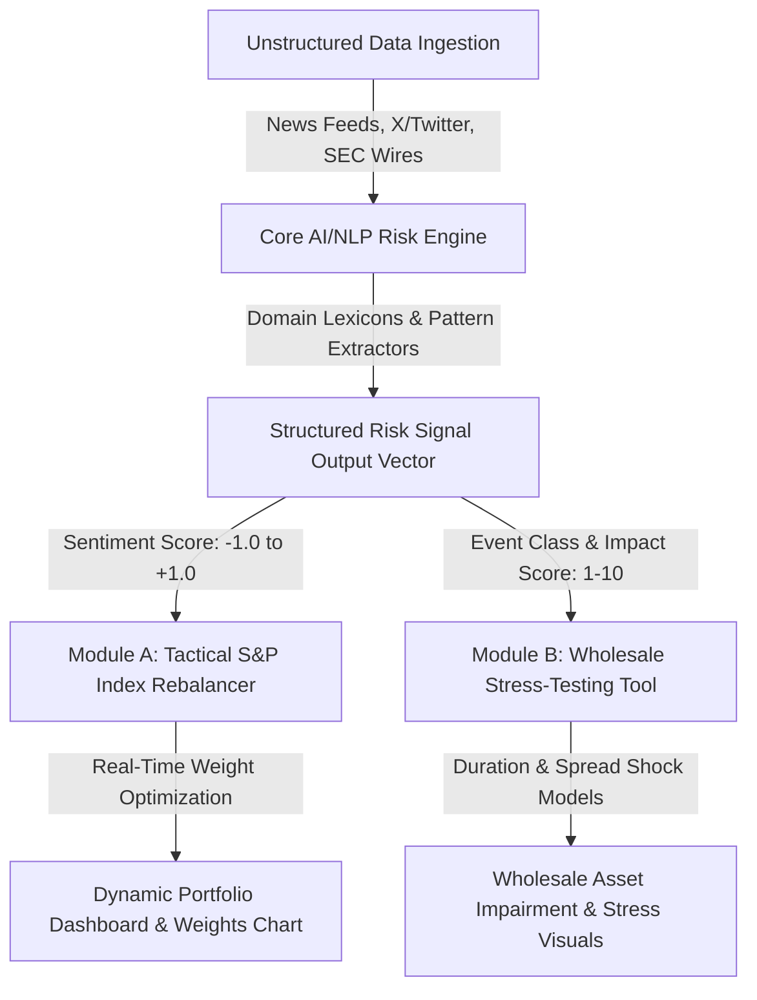

# SentinelRisk: Real-Time AI/NLP Financial Risk Engine & Capital Analytics Platform

A unified, production-ready financial NLP risk intelligence platform capable of ingesting and analyzing real-time, unstructured data (news feeds and social media) to generate actionable risk signals. 

This platform implements the **Core AI/NLP Risk Engine** alongside **BOTH** downstream financial applications:
- **Module A**: Tactical, High-Frequency Stock Index Dynamic Rebalancer (S&P 100 constituent tracking).
- **Module B**: Strategic, Event-Driven Wholesale Banking Portfolio Stress-Testing Tool ($140M synthetic multi-asset book).

Designed with a clean, lightweight, zero-configuration architecture that can be deployed instantly to **Vercel**, GitHub Pages, or any modern web host with zero backend setup.

---

## 🚀 Live Demo & Deployment

- **One-Click Vercel Deploy**: Works out of the box as a zero-dependency modern web application. Just import this repository into [Vercel](https://vercel.com) and click **Deploy**.
- **Local Browser Run**: Simply open `index.html` in any web browser.
- **Python CLI Runner**: Execute `python cli_engine.py` for headless pipeline evaluation.

---

## 🏛️ System Architecture



---

## 🔑 Core Features

### 1. Unified AI/NLP Risk Engine
- **Multi-Source Ingestion**: Capable of ingesting data from financial news terminals (Bloomberg/Reuters), social feeds (X/Twitter), and regulatory filings.
- **Sentiment Scoring**: Financial sentiment analyzer calibrated for equity and macro terminology (-1.0 = extremely bearish to +1.0 = extremely bullish).
- **Event Classification**: Categorizes events into 6 key financial taxonomies:
  - `Geopolitical`
  - `Macroeconomic`
  - `Credit Event`
  - `Regulatory / Legal`
  - `Merger & Acquisition`
  - `Product / Tech Launch`
- **Severity Impact Score**: Calibrated 1–10 scoring engine that weighs semantic intensity, systemic category risk, and event frequency.
- **Structured Output**: Generates machine-readable JSON schemas consumed downstream.

### 2. Module A: Tactical Index Rebalancer
- Tracks a mock index of 10 major blue-chip equities (`AAPL`, `MSFT`, `NVDA`, `AMZN`, `GOOGL`, `JPM`, `TSLA`, `XOM`, `PFE`, `GS`).
- Rebalances constituent weights dynamically: bullish signals increase allocation, while bearish sentiment triggers risk-off trimming.
- Maintains normalization ensuring portfolio allocation always sums to exactly 100%.
- Real-time Chart.js interactive comparison between baseline weights and AI-optimized weights.

### 3. Module B: Strategic Wholesale Banking Stress-Testing
- Evaluates a $140M synthetic banking book spanning commercial loans, corporate bonds, sovereign debt, and derivative hedges.
- Event-triggered: Automatically runs a simulated shock when severity impact $\ge 7$ or systemic events (Geopolitical, Credit default, Macro hike) are detected.
- Models duration sensitivity, credit spread blowout (in basis points), and hedge dynamics.
- Displays pre- and post-stress valuation, total loss, and portfolio drawdown.

---

## 📁 Repository Structure

```
financial-risk-engine/
├── index.html         # Interactive financial dashboard UI (TailwindCSS, Chart.js, Lucide)
├── engine.js          # Core AI/NLP Risk Engine & downstream financial math algorithms
├── app.js             # UI state controller, interactive charts, and signal stream
├── style.css          # Glassmorphism dark financial terminal styling
├── cli_engine.py      # Standalone Python implementation of the NLP Risk Engine
└── README.md          # Comprehensive documentation and project guide
```

---

## 💻 Tech Stack
- **Frontend / Dashboard**: Modern Vanilla ES6+, TailwindCSS, Chart.js, Lucide Icons.
- **Backend / Engine**: Zero-dependency modular JavaScript & Python 3.
- **Deployment**: Zero-config instant deployment to Vercel, GitHub Pages, or any static host.
